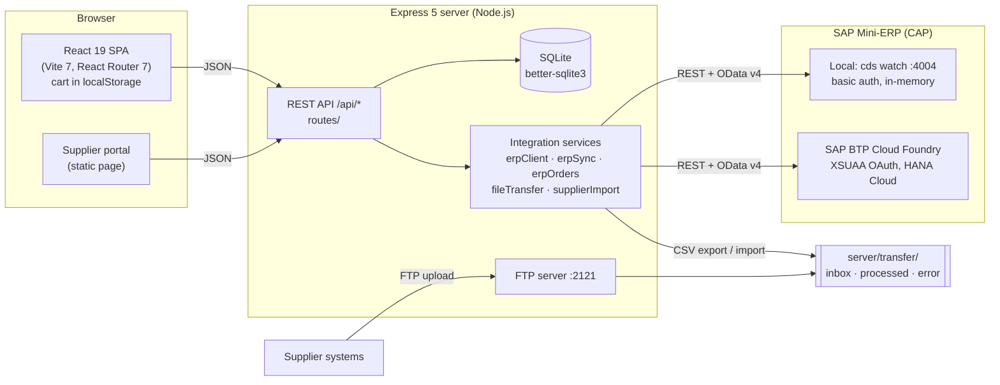

# VeloCity Bike Shop

Web shop for the Systems Integration lab (Prof. Christian Drumm, FH Aachen, winter term 2026/27).
It covers Lab 1 (simple web shop) and Lab 2 (file-based product transfer) and is integrated with the
course's SAP CAP Mini-ERP from Lab 0, either locally (`cds watch`) or on SAP BTP.

- Lab specs: <https://codeberg.org/ceedee666/systems-integration/src/branch/main/lab>
- Background and design decisions: [docs/Lab0-Guide-MiniERP-SAP-BTP.pdf](docs/Lab0-Guide-MiniERP-SAP-BTP.pdf), [docs/Lab1-Guide-VeloCity-Web-Shop.pdf](docs/Lab1-Guide-VeloCity-Web-Shop.pdf)
- Audit and readiness for Lab 3+: [LAB_AUDIT_REPORT.md](LAB_AUDIT_REPORT.md)

## Architecture



The browser only talks to the shop's own API. ERP credentials stay on the server. The ERP is the
master for products, prices, stock and orders. The shop keeps a synchronised copy in SQLite.

| Layer | Technology |
|---|---|
| Frontend | React 19, React Router 7, Vite 7, plain CSS |
| Backend | Node.js 22+, Express 5 |
| Database | SQLite via better-sqlite3 (`server/data/webshop.db`) |
| Auth | bcryptjs hashes, server-side session tokens (24 h), roles `customer` / `admin` |
| ERP | Mini-ERP REST `/rest/api` + OData v4 `/odata/v4/simple-erp`; basic auth locally, OAuth 2.0 client credentials on BTP |

## Prerequisites

- **Node.js 22.12 or newer** (22 LTS or 24 LTS). Check with `node -v`.
- **npm 10+** (ships with Node).
- **better-sqlite3** is a native module. Prebuilt binaries are downloaded for Windows, macOS and Linux
  (x64/arm64) on supported Node versions, so normally no compiler is needed. If no prebuild matches
  your platform, npm falls back to `node-gyp`, which needs Python 3 and a C++ toolchain:
  - Windows: Visual Studio Build Tools with "Desktop development with C++"
  - macOS: `xcode-select --install`
  - Linux: `build-essential` (or equivalent)
- For the ERP: the course repository and the SAP CDS CLI (`npm i -g @sap/cds-dk`), see Lab 0.

Windows PowerShell: if `npm.ps1` is blocked by the execution policy, use `npm.cmd` / `npx.cmd`.

## Local setup

```bash
# 1. Mini-ERP (once)
git clone https://codeberg.org/ceedee666/systems-integration.git
cd systems-integration/src/simple-erp
npm install

# 2. Shop
git clone <this-repo-url> velocity-webshop
cd velocity-webshop
npm run install:ci        # = npm ci: installs server + client from package-lock.json
cp server/.env.example server/.env   # optional, all values have defaults
```

Run (two terminals):

```bash
# Terminal 1 - ERP on http://localhost:4004 (user alice / alice)
cd systems-integration/src/simple-erp
npx cds watch

# Terminal 2 - shop: API on :3001, Vite dev server on :5173
cd velocity-webshop
npm run dev
```

Open <http://localhost:5173>. The header should show "Live stock from Local SAP (cds watch)".

On Windows, `start-local.cmd` starts both in separate windows. It expects the ERP in
`%USERPROFILE%\systems-integration\src\simple-erp`; change `ERP_DIR` in the file otherwise.

| Script | Purpose |
|---|---|
| `npm run install:ci` | Clean, lockfile-exact install of both workspaces |
| `npm run dev` | API (`node --watch`) + Vite dev server via `concurrently` |
| `npm run build` | Production build of the client into `client/dist` |
| `npm start` | Server only; serves `client/dist` too if it exists (everything on :3001) |
| `npm run reset-db` | Deletes `server/data`; demo data is recreated on the next start |
| `npm run cf:build` | Build + create `cf-dist/` with `manifest.yml` for `cf push` |

The project uses npm workspaces (`server`, `client`) with a single root `package-lock.json`. Do not
run `npm install` inside `client/` or `server/`; that would create a second, diverging lockfile.

### Configuration

All settings live in `server/.env` (template: [server/.env.example](server/.env.example)). Paths are
relative to `server/`, because the npm scripts start the server there. Connector settings only seed
an empty database; afterwards they are managed in *Admin > SAP connectors*.

`server/.env` and `server/xsuaa-key.json` contain secrets and are git-ignored. Never commit or zip them.

### Demo accounts

Created on first start and offered as one-click logins on the login page:

| Account | Login | Notes |
|---|---|---|
| Admin | `admin@webshop.local` / `admin123` | Hidden on the login page when `NODE_ENV=production`. In production the password must come from `ADMIN_PASSWORD`, otherwise a random one is used. |
| Customer (Max Mustermann) | `customer@webshop.local` / `customer123` | |
| Suppliers | `bikeparts`, `globalcycle`, `nordicgear`, `celticparts` / `supplier123` | Portal and FTP |

Set `DEMO_MODE=false` to hide all demo logins.

## Lab 1: web shop

| Requirement | Where to test |
|---|---|
| List products | Shop page `/` (categories, search, sort, stock badges), product page `/products/:id` |
| Add / remove products | *Admin > Products*: create, edit, remove (soft delete), restore. With an ERP active, the ERP is written first. |
| Product has name, description, price | Plus product ID (ERP key), currency, stock, category |
| Register, log in, update profile | `/register`, `/login`, *My account* (profile, address, password) |
| Customer has name, e-mail, address, purchase history | *My account > Orders* |
| Create orders via cart + checkout | Cart > Checkout > Confirmation. The order is created in the ERP first; the shop only stores it if the ERP accepts it. |
| Order stores customer, items, quantities, total, status | `orders` + `order_items` (price/name snapshot); status `NEW > PICKED > SHIPPED > COMPLETED / CANCELED` in *Admin > Orders* |

Quick check: log in as the demo customer, buy a bike, and watch the stock go down in the ERP
(<http://localhost:4004>, Fiori app *Products*). Without an active connector the shop runs standalone
with its own stock.

## Lab 2: file transfer

*Admin > File transfer* switches the active connector from the API to a file interface.

```
ERP export job --CSV--> server/transfer/inbox --> shop import
                                          |--> processed/  (success)
                                          |--> error/      (rejected + <file>.error.txt)
```

| Aspect | Implementation |
|---|---|
| Export | ERP CSV export `GET /rest/api/getProducts()`, written as `.part` then renamed into `inbox/`. Every 60 s, only if the ERP data changed (SHA-256), or *Export from ERP now*. |
| Import | Inbox polled every 10 s, or *Import inbox now* / *Upload file* (ERP CSV or the `.xlsx` from the Fiori *Export to Spreadsheet*). |
| File name | `products_<source>_<YYYYMMDDTHHMMSSZ>[-n].csv\|xlsx`, UTC |
| Semantics | Each file is a full snapshot: missing products are removed from the shop. All or nothing per file. |
| Rejected files | wrong name, other ERP, duplicate, outdated, future timestamp, empty/HTML/damaged file, missing column, invalid price/stock, duplicate product ID |

Demo: switch to *File transfer*, change a price in the ERP, wait up to a minute (or press
*Export* + *Import*), the price changes in the shop. Upload a CSV with price `abc`: it is rejected and
listed in *History* with its report.

In file mode orders stay in the shop and the next file overwrites the stock. That is the consistency
problem of batch file integration that Lab 3 (RPC) addresses.

### Supplier files (portal + FTP)

Suppliers deliver data in their own formats; the shop maps it, writes it into the ERP via OData, and
then syncs from the ERP.

- Portal: <http://localhost:3200> (also under `/portal/` of the shop)
- FTP: `ftp://127.0.0.1:2121`, upload into `/inbox`, acknowledgements in `/outbox` (plain FTP, local demo only)
- Formats: CSV (any separator, decimal comma), JSON, XML, `.xlsx`; mapping profile and field rights per
  supplier in *Admin > Suppliers*, including *Test with a file* (dry run)
- Target ERP: *Admin > Suppliers > Write supplier data to*: active connector, local, cloud or both.
  If one ERP is down the file waits and is retried automatically.
- Samples: [server/src/portal/samples/](server/src/portal/samples/) (`broken-bikeparts.csv` shows the error handling)

The local ERP is in-memory: after a `cds watch` restart, supplier-created products are gone.

## SAP BTP

**Shop locally, ERP on BTP.** Create a service key and save its JSON as `server/xsuaa-key.json`:

```bash
cf login -a https://api.cf.us10-001.hana.ondemand.com --sso
cf create-service-key simple-erp-auth-api webshop-key
cf service-key simple-erp-auth-api webshop-key   # copy the JSON part into server/xsuaa-key.json
```

Then either set `ERP_URL` and `ERP_XSUAA_KEY_FILE=./xsuaa-key.json` in `server/.env` before the first
start, or add a connector in *Admin > SAP connectors* with the "SAP BTP (Cloud Foundry)" template.

**Shop on BTP.**

```bash
npm run cf:build     # needs ERP_URL in server/.env
cd cf-dist
cf push
cf set-env velocity-webshop ADMIN_PASSWORD '<password>'
cf restart velocity-webshop
```

The cloud app gets the XSUAA credentials through a service binding. Its SQLite file lives on the
container disk and is reset on restart/push; ERP data in HANA is not affected. Trial accounts stop
every night: start HANA, then `cf start simple-erp-srv`, then `cf start velocity-webshop`.

## Troubleshooting

| Symptom | Fix |
|---|---|
| `npm.ps1 cannot be loaded` | Use `npm.cmd` / `npx.cmd` |
| `npm ci` fails with `EPERM` on Windows | A running dev server or editor locks files in `node_modules`; stop `npm run dev` and retry |
| `npm ci` says the lockfile is out of sync | Someone changed a `package.json` without committing the updated `package-lock.json`; run `npm install` once at the repo root and commit the lockfile |
| better-sqlite3 build errors | No prebuild for your Node/OS: install the C++ toolchain listed above, or use Node 22/24 LTS |
| Port 3001 / 5173 / 3200 in use | Stop the old process, or set `PORT` / `PORTAL_PORT` in `server/.env` |
| `[ftp] port 2121 is already in use` | Set `FTP_PORT=2122` (or `0` to disable) |
| "catalog is not available" | The ERP is not running; start `cds watch` and reload |
| Products/orders reset | Expected: the local ERP keeps data in memory |

## Project layout

```
client/src/        React app: pages/, components/, api.js (all /api calls), state.jsx (auth + cart)
server/src/        index.js (app wiring), db.js (schema, migrations, seed), auth.js, catalog.js
  routes/          products, customers, orders, admin, erp, fileTransfer, suppliers
  services/        erpClient, erpSync, productSync, erpOrders, erpMasterData, connectors, serviceKey,
                   inventory, fileTransfer, productFile, xlsxReader, suppliers, supplierFormats,
                   supplierImport, ftpServer
  portal/          supplier portal app, static page, sample files
scripts/           cf-prepare.mjs (Cloud Foundry package)
docs/              Lab 0 and Lab 1 guides
```
