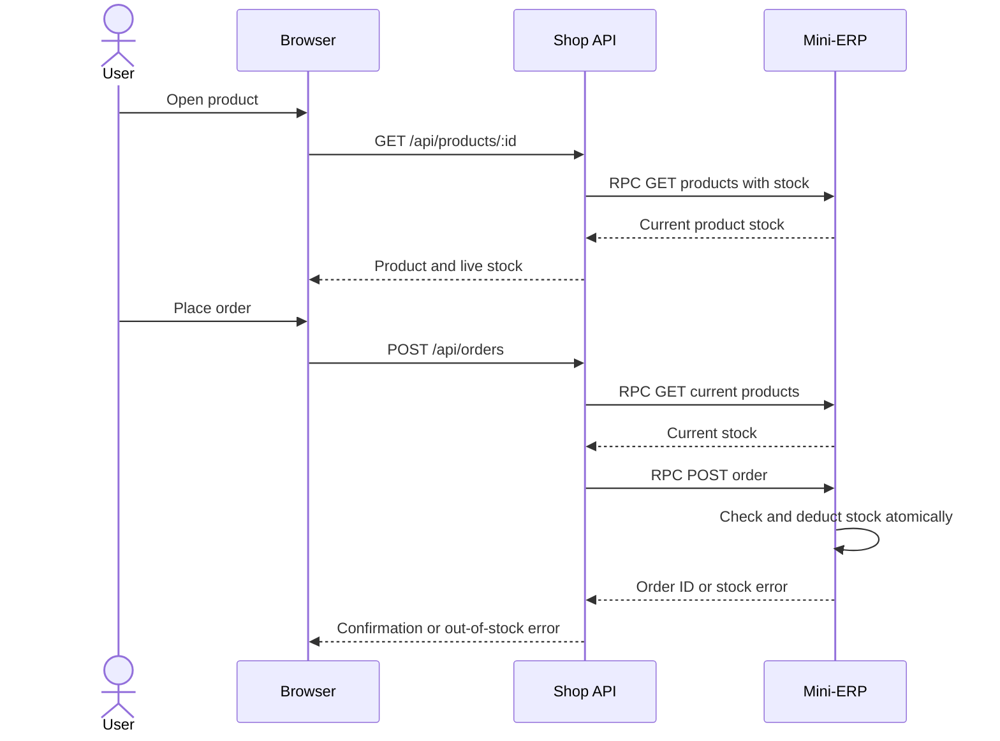
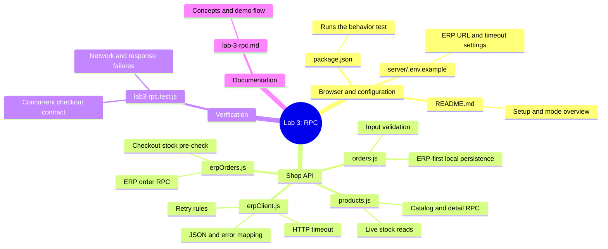

# Lab 3: RPC stock and order synchronization

## Prerequisites and knowledge needed

Before presenting Lab 3, be comfortable with the following.

### Required tools and setup

- **Node.js 22.12 or newer** and npm.
- Git and a terminal with two simultaneous terminal windows.
- This shop repository and the course `systems-integration` repository.
- A normal browser window plus one Incognito/Private window or a second browser profile for the two-user race.
- The Mini-ERP in `systems-integration/src/simple-erp`.
- Ports `4004` (ERP), `3001` (shop API), and `5173` (shop UI) must be free.
- For this repository, run `npm ci` once from the `velocity-webshop` root.
- Know the demo logins: shop admin `admin@webshop.local` / `admin123`; shop customer `customer@webshop.local` / `customer123`.

### Concepts to review

- **RPC (Remote Procedure Call):** one system invokes an operation offered by another system and waits for a response. Here, the shop server calls the ERP's REST/OData endpoints.
- **Synchronous request/response:** checkout waits for the ERP to accept or reject the order before telling the browser that the purchase succeeded.
- **REST and OData over HTTP:** resources and actions are addressed by URLs, data uses JSON, and HTTP status codes communicate results.
- **Source of truth:** the ERP owns authoritative stock and purchase orders. SQLite keeps shop-only data and local copies, but it does not decide API-mode stock.
- **Atomic transaction:** the ERP must check and deduct stock as one indivisible operation so only one competing order can consume the final unit.
- **Race condition / concurrency:** two requests may read the same old stock. Correctness comes from the atomic ERP order operation, not only from the earlier stock query.
- **Timeouts:** a synchronous caller must stop waiting after a configured limit. `ERP_TIMEOUT_MS` controls the ERP timeout.
- **Safe retries:** reads can be retried because they do not change data. Order POSTs are not retried automatically because a timed-out response may still have committed the order.
- **Idempotency and duplicate orders:** retrying the same non-idempotent create operation can create two orders.
- **HTTP errors:** `400` means invalid request data, `409` means a current state conflict such as stock, `502` means an invalid/upstream ERP response, and `503` means the ERP cannot be reached.
- **Failure isolation:** the shop returns a clear error and does not present old SQLite stock or create a local order when the API-mode ERP rejects the request.
- **File transfer versus RPC:** file transfer is suitable for periodic snapshots, but synchronous RPC is needed when checkout requires current stock and an immediate answer.

## Progression

- **Lab 0:** A SAP CAP Mini-ERP owns product and order data.
- **Lab 1:** A React and Express web shop adds customers, carts, checkout, and a local SQLite order copy.
- **Lab 2:** Product snapshots move through files. This is useful for batch exchange, but stock can be stale between imports.
- **Lab 3:** API mode uses real-time RPC calls. The ERP is authoritative for stock and purchase-order creation.

## Goal and RPC concepts

Lab 3 replaces delayed stock decisions with a request/response exchange:

1. The shop asks the ERP for current products and stock whenever a catalog or product page is opened.
2. Checkout asks the ERP for stock again immediately before creating an order.
3. The shop sends the order to the ERP. The ERP checks and deducts stock atomically, then returns an order ID or a failure.

The browser never calls the ERP directly. The Express server is the RPC client and keeps ERP credentials server-side.



## Implementation and design choices

### One rule for stock

In API mode, the ERP decides whether stock is available. Product and checkout requests call the ERP before using stock values. SQLite still stores a stock column for standalone and Lab 2 file-transfer modes, but an API-mode response does not treat that column as authoritative.

### Why the checkout pre-check is not enough

Checkout reads current stock before creating an order, but two users can receive the same answer. The actual safety guarantee therefore comes from the ERP's create-order transaction: it checks and deducts stock atomically. With one unit remaining, one order succeeds and the other is rejected.

The shop saves a local order only after the ERP confirms creation. A rejected ERP order never produces a shop order.

### Failure policy

The implementation uses a small, predictable set of responses:

- `400`: the shop received an invalid cart payload.
- `409`: the ERP rejected the current business state, such as insufficient stock.
- `502`: the ERP returned an invalid response or continued to fail with a server error.
- `503`: the ERP could not be reached or the call timed out.

Read calls may be retried. Order creation is not retried because the ERP might have committed the first request before its response was lost. Retrying could create two orders for one customer click.

`ERP_TIMEOUT_MS` controls the wait limit and defaults to 10 seconds. There is no stock cache in API mode; immediate correctness matters more than saving an RPC call during checkout.

## Why RPC for Lab 3

- File transfer was appropriate for Lab 2 batch updates, but cannot provide immediate stock decisions.
- Shared database access would bypass the ERP's transaction and business rules.
- Asynchronous messaging gives useful decoupling, but eventual delivery cannot produce the immediate confirmation required here.
- A direct browser-to-ERP call would expose credentials and weaken the shop's control over validation and error mapping.

RPC therefore gives a small, explicit contract and synchronous feedback. Its tradeoffs are tight availability and service coupling: if the ERP is unavailable, checkout is unavailable in API mode rather than risking overselling.

## Live demo

Follow the demos in order. Each one builds on the previous result, from showing the integration style to proving concurrent checkout safety.

### Prepare both applications

1. In terminal 1, start the Mini-ERP:

   ```text
   cd systems-integration/src/simple-erp
   npm install
   npx cds watch
   ```

2. Wait for the ERP to serve on port `4004`.
3. In terminal 2, start the shop from `velocity-webshop`:

   ```text
   npm ci
   npm run dev
   ```

4. Wait for the UI on <http://localhost:5173> and the API on <http://localhost:3001>.
5. Open the shop in a normal browser window.
6. If the in-memory ERP was restarted and products disappeared, use **Admin > SAP connectors > Load demo catalog** before presenting.

### Demo 1: Switch from file transfer to live RPC

**Purpose**

Show the difference between Labs 2 and 3. Lab 2 imported delayed snapshots through files. Lab 3 uses a live request to the ERP and gives the ERP ownership of stock and orders.

**Show this on screen**

The connector must identify its mode as **API - REST/OData, live**. The management table should say that the ERP owns product stock through REST and orders through OData `POST /Orders`.

**Steps**

1. Click **Log in**.
2. Under **Demo accounts**, click **Log in** for **Administrator**.
3. Click **SAP connectors**.
4. Find **Local SAP (cds watch)**.
5. If its product data mode is file transfer, click **Edit**.
6. Under **Product data reaches the shop via**, select **API - REST/OData, live (orders are created in the ERP)**.
7. Click **Save**.
8. Wait for the saved notification. Click **Load demo catalog** if the catalog is incomplete.
9. Point to **Product data: API - REST/OData, live**.
10. Scroll to **What is managed where** and point to `REST /rest/api/products()` and `OData POST /Orders`.

**Speaker notes**

> "In Lab 2, the shop received product files. That works for batch synchronization, but a file can be several minutes old. In Lab 3, a browser request goes to the shop API, which calls the ERP immediately. The browser receives no ERP credentials and talks only to the shop. The important ownership change is that stock and purchase orders are now authoritative in the ERP."

**What this proves**

The application is configured for synchronous RPC, not file-based synchronization. The later demos can now rely on current ERP data.

### Demo 2: Read stock from the ERP in real time

**Purpose**

Prove that a product page does not trust a stale local stock value. Every product view requests the current ERP stock.

**Show this on screen**

A stock change made through the admin UI appears immediately in the customer-facing shop, with the text **Live stock from Local SAP (cds watch)**.

**Steps**

1. As admin, click **Products**.
2. Find **Water Bottle** (`BOTL0100`) and note its stock.
3. Click **Edit** in that row.
4. Set **Stock** to `2` and click **Save**.
5. Point to the note saying the change is saved in the SAP ERP first.
6. Click **Shop** in the top navigation.
7. Find **Water Bottle** and point to **Only 2 left**.
8. Click the product card.
9. Point to **2 available** and **Price and stock are live from the SAP ERP**.
10. Optional: open DevTools **Network**, refresh, and show the `GET /api/products/12` response containing `stock: 2`.

**Speaker notes**

> "The admin update went to the ERP first. When I opened the shop page, the shop server made another RPC to obtain product data and stock. SQLite still contains a copy for old standalone and Lab 2 modes, but this response is using the ERP value. If the ERP says two, the shop shows two; it does not wait for a scheduled sync or a file import."

**What this proves**

Product display is synchronized on demand. The browser sees current stock through the shop API, while ERP credentials remain on the server.

### Demo 3: Create a successful order in the ERP

**Purpose**

Show the normal purchase flow from browser to shop API to ERP, including the ERP order ID and the stock deduction.

**Show this on screen**

Checkout identifies the ERP as the system checking stock. The confirmation includes an ERP order number, and reopening the product shows one fewer item.

**Steps**

1. Log out of the admin account.
2. Log in with the demo **Customer** account, or register a fresh customer with a complete address.
3. Open **Floor Pump** and write down its availability, for example `18 available`.
4. Click **Buy now**.
5. Click **Proceed to checkout**.
6. Point to **Your order is created in the SAP ERP, which also checks the stock.**
7. Click **Place order**.
8. Point to the confirmation text **It has been created in the SAP ERP as order #...**.
9. Click **Continue shopping**, reopen **Floor Pump**, and show that stock decreased by one.
10. Log in as admin and open **Admin > Orders**. Show the shop order and its `ERP #...` identifier.

**Speaker notes**

> "The checkout request contains the shop's product reference and quantity. The shop resolves that product to the ERP ID, checks current stock, and sends an ERP order creation RPC. The shop does not save a successful local order before the ERP answers. The ERP's success response contains the order ID, and only then does SQLite save a local copy for the customer's order history. Refreshing the product gives us independent proof that the ERP deducted stock."

**What this proves**

The success path is synchronous and centralized: the ERP creates the order, deducts stock, and returns the confirmation used by the shop.

### Demo 4: Two buyers compete for the final unit

**Purpose**

Demonstrate the critical concurrency case. A pre-check can see one item for both buyers, so the atomic ERP order operation must decide which purchase wins.

**Show this on screen**

One browser reaches order confirmation. The other remains at checkout with an out-of-stock conflict. The product becomes out of stock and only one new order exists.

**Prepare the race**

1. Log in as admin and open **Products**.
2. Edit **Water Bottle**, set stock to `1`, and click **Save**.
3. Open the shop in a normal window and a separate Incognito/Private window or browser profile. Separate sessions are required.
4. Register a different customer in each window with a complete shipping address.
5. In both windows, open **Water Bottle** and verify **Only 1 left**.
6. In both windows, click **Buy now**, then **Proceed to checkout**.
7. Stop with both checkout pages visible.

**Trigger and verify**

1. Put both **Place order - 9,90 EUR** buttons on screen.
2. Count down and click both buttons together.
3. Point to the winning confirmation and its ERP order number.
4. Point to the losing checkout error, which will say either:
   - `ERP: Not enough stock for the requested product...`, or
   - `Not enough stock for "Water Bottle" (available: 0)`.
5. Open **My orders** in the losing account and show that no order was created there.
6. Refresh **Water Bottle** and show **Out of stock**.
7. As admin, show that only one additional order was created and stock is now zero.

**Speaker notes**

> "Both users started when the product showed one item. That is the race condition. If both shop requests read stock first, both initially see one. The stock read alone cannot reserve anything. The ERP's order creation is the serialization point: it checks and deducts stock inside one atomic transaction. The first processed order consumes the unit. The next ERP order checks the new stock and is rejected. Depending on timing, the loser can be rejected by the shop's fresh pre-check or by the ERP order transaction. The important outcome is always the same: one success, one clear failure, zero overselling."

**What this proves**

The system protects inventory under concurrent requests and reports the result immediately to the second user.

### Demo 5: ERP outage and recovery

**Purpose**

Show the availability cost of synchronous RPC and prove that the shop does not sell based on stale stock when the ERP is unavailable.

**Show this on screen**

A product request fails with `ERP not reachable`, and browser DevTools shows a `503`. After restarting the ERP, the same page returns live stock again.

**Steps**

1. Open a product page and note its displayed stock.
2. In the terminal running `cds watch`, press `Ctrl+C`. Keep the shop server running.
3. Refresh the product page.
4. Point to `ERP not reachable (ECONNREFUSED)` and the absence of stale stock or a purchase control.
5. In DevTools **Network**, point to the product request with status `503`.
6. Restart the ERP with `npx cds watch` in its terminal.
7. Because the local ERP database is in memory, use **Admin > SAP connectors > Load demo catalog** if needed.
8. Refresh the product page and show live stock again.
9. Use the same customer to place another order. Point out that the shop resolves the customer again by e-mail after the ERP restart.

**Speaker notes**

> "A live RPC integration has a clear tradeoff: the shop depends on ERP availability at the moment of use. We deliberately fail closed. Continuing with an old SQLite value could oversell, so the user sees an availability error instead of a stale purchase option. When the ERP returns, the RPC path works again. I am also demonstrating recovery: because this local ERP stores data in memory, customer records disappear on restart. The shop re-finds or recreates the customer by e-mail instead of sending an obsolete ERP customer ID."

**What this proves**

RPC failures are visible and safe. An unavailable ERP blocks product stock and checkout rather than allowing an unsafe local fallback.

### Demo 6: Verify timeout, retry, and invalid-data rules

**Purpose**

Reproduce edge cases that are difficult to create consistently by hand and explain why safe reads may be retried while order creation may not.

**Show this on screen**

The terminal test completes with `1 pass, 0 fail` and names the Lab 3 behavior suite.

**Steps**

1. Open a terminal in `velocity-webshop`.
2. Run:

   ```text
   npm test
   ```

3. Point to **Lab 3 RPC checkout and failure behavior**.
4. Point to `1 pass, 0 fail` in the final summary.
5. Explain the verified cases listed below.

**Cases covered by the test**

- Two requests compete for one ERP unit; one is `201` and one is a stock conflict.
- Final ERP stock and the next product response both show zero.
- A temporary ERP `500` on a read is retried.
- Invalid ERP JSON becomes `502`.
- An ERP timeout and an unavailable ERP become `503`.
- Invalid cart data becomes `400` before order creation.
- A create-order POST is not automatically retried.

**Speaker notes**

> "Reads are safe to repeat because they do not create or change business data. A stock query can therefore retry after a temporary server failure. Order creation is different. If the ERP committed an order but the response was lost, retrying the POST could create a second order. The implementation reports the ambiguous failure instead of blindly retrying. Input validation is separate: malformed product IDs and quantities are rejected at the shop boundary before the ERP is called."

**Optional invalid-payload demonstration**

While logged in, run this in browser DevTools **Console**:

```javascript
fetch('/api/orders', {
  method: 'POST',
  headers: {
    'Content-Type': 'application/json',
    Authorization: `Bearer ${localStorage.getItem('webshop.token')}`
  },
  body: JSON.stringify({ items: [{ productId: 'invalid', quantity: 1 }] })
}).then(async response => console.log(response.status, await response.json()));
```

The result is `400` with `Each cart item needs a valid product ID.` No ERP order is sent.

**What this proves**

The RPC boundary handles concurrency, temporary failures, malformed upstream responses, invalid client input, and ambiguous write timeouts deliberately rather than relying on best-effort behavior.

## Lab 3 file mind map



### File responsibility table

The first nine rows are files changed by the Lab 3 commit. `inventory.js` is included separately because it is existing code called by the checkout route and helps explain the local-mode race guard.

| File | Changed in Lab 3? | What it does | Relevant concern |
|---|:---:|---|---|
| `server/src/routes/products.js` | Yes | Fetches live ERP products and replaces SQLite stock in catalog/detail responses | Live stock RPC; fail closed when ERP is unavailable |
| `server/src/services/erpClient.js` | Yes | Central HTTP/RPC client for REST and OData | Timeout, connectivity `503`, retryable `5xx`, malformed JSON `502`, error mapping, no write retries |
| `server/src/services/erpOrders.js` | Yes | Resolves customers/products, performs a fresh stock pre-check, and posts the ERP order | Checkout race gap; synchronous ERP decision |
| `server/src/routes/orders.js` | Yes | Validates cart input, calls ERP first, then mirrors the accepted order locally | Payload validation; no local order after ERP rejection; local atomic SQLite transaction |
| `server/test/lab3-rpc.test.js` | Yes, added | Drives two checkout requests, ERP failures, malformed responses, and timeouts | Verifies one winning checkout in the fake ERP and failure handling |
| `server/.env.example` | Yes | Documents `ERP_TIMEOUT_MS` and RPC configuration | Network timeout setup |
| `package.json` | Yes | Adds/runs the server test command | How to execute Lab 3 verification |
| `README.md` | Yes | Documents API mode and ERP-first checkout | User-facing setup and mode explanation |
| `docs/lab-3-rpc.md` | Yes, added | Lab presentation, concepts, demos, and this navigation map | Learning and presentation guide |
| `server/src/services/inventory.js` | No | Existing local stock reservation helper used in non-ERP mode | Race-safe local `UPDATE ... WHERE stock >= quantity` |

### Quick route to each problem

| Question | Start here | Then follow |
|---|---|---|
| Where is live stock fetched? | `products.js` → `liveStockById()` | `erpClient.js` → `products()` |
| How are network/timeouts handled? | `erpClient.js` → `fetchWithTimeout()` | `call()` → Express error handler in `server/src/index.js` |
| Which ERP errors are retried? | `erpClient.js` → `call()` | Retryable timeout/503 and ERP 5xx; order POST uses `retries: 0` |
| Where is the checkout stock pre-check? | `erpOrders.js` → `ensureErpProductIds()` | `createErpOrder()` → ERP `POST /Orders` |
| Where is the final ERP stock decision intended to occur? | ERP `simpleerp-service.js` | `simpleerp.js` → `updateProductStock()` |
| Where is the race-safe local stock update? | `inventory.js` → `reserve()` | Wrapped by `orders.js`'s SQLite transaction |
| Where are local orders created? | `orders.js` → `router.post('/')` | ERP success first, then local `INSERT`s |
| Where is the concurrent behavior tested? | `lab3-rpc.test.js` → two `Promise.all` checkout requests | Fake ERP drains pending requests in order |

> **Important distinction:** CAP provides transaction/rollback semantics for an ERP request, but the current ERP handler performs a stock read followed by an absolute update. The strongest explicit check-and-decrement guard in this repository is the conditional SQLite `UPDATE` in `inventory.js`; the fake-ERP test verifies the shop-side contract rather than proving simultaneous CAP database isolation.
